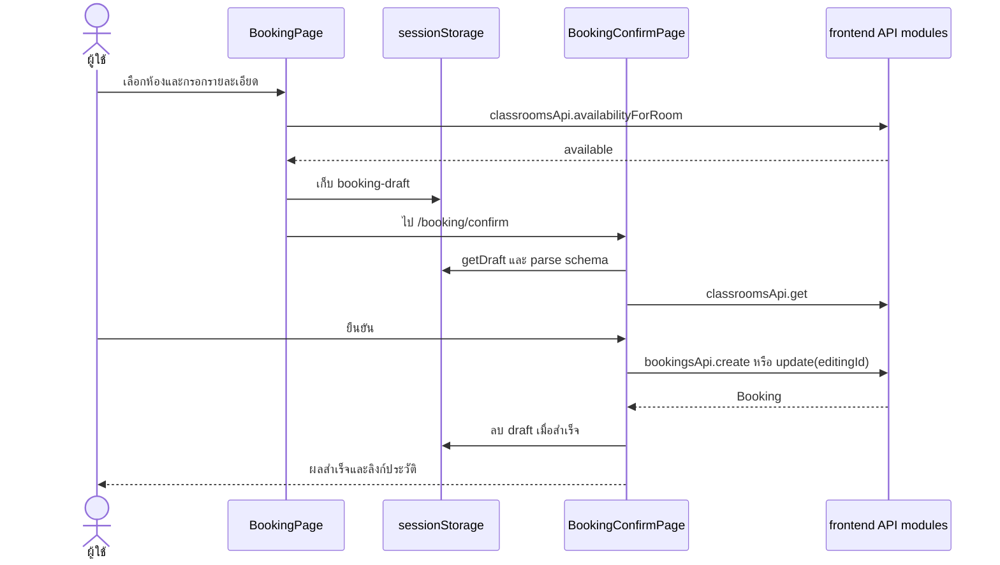

# คู่มือส่งต่องาน frontend

เอกสารสำหรับนักพัฒนาที่ต้องรับช่วงระบบจองห้องเรียน อ้างอิงซอร์ส frontend ที่ตรวจเมื่อ **26 ตุลาคม 2569** จากซอร์สที่อัปเดตหลังถอดระบบข้อมูลจำลองเดิม อธิบายพฤติกรรมที่มีในโค้ด ไม่ได้รับรองการทำงานภายใน backend

## ลำดับการอ่าน

1. อ่านเอกสารหน้านี้เพื่อเข้าใจโครงสร้าง ข้อมูล และ flow หลัก
2. อ่าน [บริการ API และ Query hooks](services.md) เมื่อต้องเชื่อม endpoint หรือแก้การโหลด/บันทึกข้อมูล
3. อ่าน [ฟังก์ชันและหน้าจอ](functions.md) เพื่อค้นหน้าที่ของคอมโพเนนต์ ฟังก์ชันภายใน store, schema และ utility ตามไฟล์

ดู [โครงสร้างโฟลเดอร์](structure.md) และ [คู่มือ Vitest](testing.md) สำหรับคำสั่ง ขอบเขต และแนวทางเพิ่ม tests

ครอบคลุมฟังก์ชันที่ประกาศชื่อ เมธอดใน service และ callback ที่ทำงานสำคัญภายในทุกโมดูล TS/TSX ของ `src` โดย callback ทั่วไป เช่น `map`, `filter`, ตัวแสดงเซลล์และตัวเปลี่ยน state จะอธิบายรวมกับหน้าที่เรียกใช้ ไม่แจกแจง callback แต่ละตัวของไลบรารี

> หน้าจอทั้งหมดใช้ API จริง ระบบ mock, seed data และการแจ้งเตือนจำลองถูกถอดออกแล้ว ไม่มี fallback เป็นข้อมูลในเครื่องเมื่อ API ล้มเหลว README หลักยังมีคำอธิบายรุ่นเก่าและไม่ได้แก้ตามขอบเขตที่ผู้ดูแลกำหนด ให้ใช้เอกสารชุดนี้สำหรับการพัฒนาต่อ

## เริ่มพัฒนา

```sh
npm install
cp .env.example .env
npm run dev
```

หากมี `.env` อยู่แล้ว ให้แก้เฉพาะค่าที่จำเป็น ไม่คัดลอกทับการตั้งค่าเดิม ต้องมี backend ที่เข้าถึงได้และอนุญาต origin ของ frontend ผ่าน CORS

| คำสั่ง | ผลลัพธ์ |
| --- | --- |
| `npm run dev` | เปิด Vite development server |
| `npm run build` | `tsc -b` ตรวจ TypeScript แล้ว `vite build` สร้าง `dist` |
| `npm run preview` | เปิดดู `dist` ที่ build แล้ว |
| `npm run lint` | รัน ESLint รวมกฎ React Hooks และ Fast Refresh |
| `npm run test` | รัน Vitest สำหรับ API contracts, HTTP clients, query cache, stores, schema และ utilities |
| `npm run test:watch` | เฝ้าการเปลี่ยนไฟล์และรันทดสอบระหว่างพัฒนา |

ไม่ใส่บัญชี รหัสผ่าน หรือ token จริงในเอกสารและไฟล์ตัวอย่าง ให้ขอบัญชีทดสอบจากผู้ดูแล backend แยกกันสำหรับผู้ใช้และแอดมิน

### การตั้งค่า

| ไฟล์/ตัวแปร | หน้าที่ปัจจุบัน |
| --- | --- |
| `.env.example` | ตัวอย่างค่าที่ Vite อ่านตอนเริ่มรันหรือ build |
| `VITE_API_BASE_URL` | API base URL; ถ้าไม่กำหนดใช้ `https://classroom-booking-backend.vercel.app/api` |
| `VITE_R2_PUBLIC_BASE_URL` | โมดูล upload อ่านและ export พร้อมค่า R2 สาธารณะสำรอง แต่การหา key เพื่อลบภาพยังไม่ได้ใช้ค่านี้ตรวจ origin |
| `VITE_APP_NAME`, `VITE_APP_VERSION` | มีในตัวอย่าง แต่ยังไม่ได้ถูกอ่านโดยโค้ดแอป |
| `vitest.config.ts` | ตั้งค่า Node tests, setup/storage, HTTP guard, timezone และ restore spies; ดู [คู่มือทดสอบ](testing.md) |
| `vite.config.ts` | ตั้ง React plugin ไม่มี dev proxy; เบราว์เซอร์เรียก backend โดยตรง |
| `tsconfig.test.json` | แยกตรวจ type ของ `tests` โดยสืบทอด compiler options จาก app config และรวมใน `tsc -b` |
| `tsconfig.app.json` | ตรวจเฉพาะ `src` ด้วย strict mode, ตรวจตัวแปร/พารามิเตอร์ที่ไม่ใช้ และใช้ JSX แบบ `react-jsx` |
| `eslint.config.js`, `.prettierrc.json` | กฎตรวจและจัดรูปแบบโค้ด; โค้ดเดิมมีรูปแบบปะปนกันอยู่ |
| `vercel.json` | rewrite เส้นทาง SPA ไป `index.html` |
| `index.html` | ตั้งชื่อเว็บ ภาษาเริ่มต้น `th`, favicon และโหลด `src/main.tsx` |

ค่า `VITE_*` เป็นข้อมูลสาธารณะใน frontend การเปลี่ยนค่าบน hosting ต้อง build ใหม่ตามขั้นตอนของระบบเผยแพร่

## โครงสร้างและผู้รับผิดชอบข้อมูล

```text
src/main.tsx → App → Providers → ApplicationRouter → AppLayout/หน้า auth
                                      ↓
                                feature component
                                      ↓
                          shared/hooks/queries.ts (cache)
                                      ↓
                            api/*.ts (adapter/HTTP)
                                      ↓
                                backend API

stores/authStore.ts → token → Axios interceptor
stores/themeStore.ts → Providers + CSS tokens + Analytics
```

| ชั้น | ข้อมูลที่ดูแล | ตัวอย่าง |
| --- | --- | --- |
| React local state | ตัวกรอง UI, modal, รายการที่เลือก, วันที่/มุมมองตาราง | `useState`, `useMemo` ในหน้า feature |
| React Hook Form / Ant Design Form | ค่าฟอร์มและ validation | ฟอร์ม auth/booking ใช้ RHF+Zod; ฟอร์ม profile/admin ใช้ Ant Design |
| TanStack Query | ข้อมูล API และสถานะโหลด/ผิดพลาด | `useClassrooms`, `useAdminBookings` |
| Zustand | session ของแต่ละ portal และธีม | `useUserAuth`, `useAdminAuth`, `useThemeStore` |
| URL / router state | เงื่อนไขเข้าหน้าและข้อมูลส่งต่อ | query `room/date/start/end/booking`, `state.draft`, `state.from` |
| Browser storage | session, ภาษา, ธีม และ draft | ตารางด้านล่าง |

`src/features` แยกตามงาน, `src/shared/components` เป็น UI ที่ใช้ซ้ำ, `src/app/config` เก็บเมนู และ `src/shared/config` เก็บธีม, `src/shared/constants` เก็บสถานะ/อุปกรณ์/วันสำคัญ, `src/shared/i18n` เก็บคำแปล

## เส้นทางและสิทธิ์

| เส้นทาง | คอมโพเนนต์ | เงื่อนไข |
| --- | --- | --- |
| `/` | `Navigate` | ไป `/rooms` |
| `/login`, `/admin/login` | `LoginPage` | ส่ง `portal="admin"` เฉพาะหน้าหลังบ้าน |
| `/register` | `RegisterPage` | สมัครเป็น `USER` ผ่าน API |
| `/rooms` | `RoomListPage` | สาธารณะ |
| `/rooms/:roomId` | `RoomDetailPage` | สาธารณะ |
| `/room-schedule` | `RoomSchedulePage` | สาธารณะ; รับ query `room` |
| `/booking` | `BookingPage` | session ผู้ใช้; รับ query `room/date/start/end` หรือ `state.draft` |
| `/booking/confirm` | `BookingConfirmPage` | session ผู้ใช้และ draft ที่ parse ได้ |
| `/booking-history` | `BookingHistoryPage` | session ผู้ใช้; รับ query `booking` |
| `/profile` | `ProfilePage` | session ผู้ใช้ |
| `/admin` | `Navigate` | ไป `/admin/dashboard` ภายใต้ guard แอดมิน |
| `/admin/dashboard` | `DashboardPage` | session แอดมินและ role `ADMIN` |
| `/admin/rooms` | `AdminRoomsPage` | เช่นเดียวกัน |
| `/admin/bookings` | `AdminBookingsPage` | เช่นเดียวกัน |
| `/admin/users` | `AdminUsersPage` | เช่นเดียวกัน |
| `/admin/reports` | `ReportsPage` | เช่นเดียวกัน |
| `/admin/audit-logs` | `AuditLogsPage` | เช่นเดียวกัน |
| `/403`, `/500`, เส้นทางอื่น | `ErrorPage` | แสดง 403/500/404 |

หน้าแอดมินทั้ง 6 ใช้ `lazy` และ `Suspense` แต่หน้าผู้ใช้ import ตามปกติ ข้อผิดพลาดใน route ของ layout แสดง `ErrorPage` รหัส 500 ส่วนข้อผิดพลาดโหลดข้อมูลทั่วไปแสดง `QueryState` ในหน้า

`PermissionGuard` ตรวจจาก `user` ใน store ไม่ได้ตรวจ token expiry หรือสถานะบัญชีกับ server โดยตรง การอนุญาตที่เชื่อถือได้ยังเป็นหน้าที่ backend

## แบบจำลองข้อมูล

อ้างอิง [src/shared/types/index.ts](../../src/shared/types/index.ts) และ type เฉพาะ API ใน [services.md](services.md)

| Type | ฟิลด์/ความหมายหลัก |
| --- | --- |
| `Role` | `USER`, `STUDENT`, `TEACHER`, `STAFF`, `ADMIN` |
| `User` | `id`, `firstName`, `lastName`, `email`, `phone`, `role`, `status`, `registeredAt`; ไม่มีฟิลด์ password ในโมเดลผู้ใช้ |
| `Room` | `id/code/name/building/floor/capacity/description/equipment/status/image/category`; `floor` เป็น number |
| `BookingDraft` | `roomId`, `date` แบบ `YYYY-MM-DD`, `start/end` แบบ `HH:mm`, `attendees`, `purpose`, `equipment`, `note`, `editingId?` |
| `Booking` | เพิ่ม `id`, `userId`, `status`, `createdAt`, `reason?`, `room?` จาก draft |
| `BookingStatus` | `PENDING`, `APPROVED`, `IN_USE`, `REJECTED`, `CANCELLED`, `COMPLETED`, `NO_SHOW` |
| `BookingNotification` | `id/userId/bookingId/title/message/createdAt/readAt/kind`; `bookingId` และ `readAt` เป็น null ได้ |

Room status คือ `ACTIVE/INACTIVE/MAINTENANCE`; user status คือ `ACTIVE/INACTIVE/SUSPENDED` การ์ดห้องใช้ `busy` แยกจาก room status ไม่ได้มีสถานะ `BUSY` ใน API room model

### จุดแปลงข้อมูลที่ต้องคงให้ตรงกัน

- Backend `CONFIRMED` ↔ frontend `APPROVED` สำหรับการจอง/ตัวกรอง อย่าส่ง `APPROVED` ตรงไปยัง endpoint ที่คาดหวัง `CONFIRMED`
- `classroomId → roomId`, `attendeeCount → attendees`, `requestedEquipment → equipment`, `description → note`, `imageUrl → image`
- API adapters รวม `auth.asUser` และ `users.toProfile` ใช้ `String(user.id)` จาก backend เหมือนกัน ไม่ใช้ `userCode` แทน ID เพื่อให้การเทียบเจ้าของการจองและ session ตรงกับ API
- `auth.asUser` และ `users.toProfile` ยุบ role ที่ไม่ใช่ `ADMIN` เป็น `USER`; `admin.toUser` คง role เดิม
- Payload จองใช้ `+07:00` แต่ parse/แสดงวันเวลาส่วนใหญ่ใช้ timezone ของ browser; เฉพาะ Audit logs กำหนด `Asia/Bangkok` ชัดเจน การทดสอบข้าม timezone ต้องดูทั้ง payload และข้อความหน้าจอ

## Flow หลักที่ต้องเข้าใจ

### เข้าสู่ระบบและออกจากระบบ

1. Guard เก็บ path+query ใน `state.from` แล้วส่งไป login ของ portal ที่เกี่ยวข้อง
2. `LoginPage` ตรวจฟอร์ม → `authApi.login` → adapter แปลง user → ตรวจ role ให้ตรง portal
3. บันทึก remembered username ตาม checkbox แล้วเรียก `setSession(user, token)` ของ portal นั้น
4. กลับ `state.from` ที่ผ่านเงื่อนไข หรือไป `/rooms`/`/admin/dashboard`
5. Axios อ่าน token จาก store ตอนส่งแต่ละคำขอ HTTP 401 ล้างเฉพาะ portal นั้น
6. ปุ่ม logout เรียก API และล้าง local session ใน `finally` ปัจจุบันถ้า API reject คำสั่ง navigate ที่ตามหลัง `finally` อาจไม่ทำงาน

### จองใหม่และแก้ไข



การแก้ไขเริ่มจากประวัติ ส่ง `{ ...booking, editingId: booking.id }` ผ่าน `state.draft` เข้าฟอร์ม ใช้ flow ยืนยันเดียวกัน ขั้นตอน availability ปัจจุบันไม่ส่ง `editingId` ให้ endpoint จึงต้องตรวจพฤติกรรมเวลาทับซ้อนรายการเดิมก่อนเปลี่ยน flow นี้

การเรียก availability ไม่ใช่การล็อกห้อง Frontend ส่งคำขอจริงเมื่อกดยืนยันเท่านั้น และพึ่ง backend ในการตรวจความถูกต้องพร้อมกันหลายผู้ใช้

### แอดมินและรายงาน

- หน้าจัดการเรียก admin hooks → รับตัวกรองจาก state → action ผ่าน `useAction` → invalidate queries → ตาราง/รายละเอียดโหลดใหม่
- แก้ผู้ใช้เดิมเรียก update ข้อมูลทั่วไป จากนั้น role และ status ทีละคำขอ จึงอาจสำเร็จเพียงบางขั้นตอน
- Dashboard ใช้ summary + report summary + recent bookings + bookings 7 วัน + rooms ข้อมูลกราฟแต่ละชุดอาจคนละขอบเขต
- Reports รวม 4 API ด้วย `Promise.all`; summary ไม่รับ filters แต่ bookings/classrooms/users รับ filters ถ้า API ใดล้มเหลว query รวมถือว่าล้มเหลว
- Export เรียก backend รับ Blob สร้าง object URL ดาวน์โหลด `.csv` แล้ว revoke URL ไม่มีการสร้าง Excel/PDF ใน frontend

## การเก็บข้อมูลและแคช

| Storage key | เนื้อหา/ผู้อ่าน |
| --- | --- |
| `classroom-user-auth` | Zustand persist สำหรับ user/token ผู้ใช้ |
| `classroom-admin-auth` | Zustand persist สำหรับ user/token แอดมิน |
| `classroom-auth` | session เก่าสำหรับ migration เมื่อคีย์ใหม่ยังไม่มี |
| `classroom-remembered-username:user`, `classroom-remembered-username:admin` | ชื่อผู้ใช้เท่านั้น ไม่เก็บ password |
| `classroom-theme` | mode `light/dark` |
| `classroom-language` | ภาษา i18next |
| `booking-draft` (sessionStorage) | draft ระหว่างฟอร์มและหน้ายืนยัน |

แอปไม่อ่านหรือสร้างฐานข้อมูลจำลองใน localStorage อีกต่อไป ข้อมูล `classroom-database-v1` ที่อาจค้างจากรุ่นเก่าจะถูกละเว้น และลบด้วยเครื่องมือเบราว์เซอร์ได้โดยไม่กระทบข้อมูล backend; session migration จาก `classroom-auth` ยังอยู่เพื่อรองรับรูปแบบ session เก่า ไม่ใช่ฐานข้อมูลจำลอง

Query defaults: stale 10 วินาที, retry 1, refetch เมื่อ focus; business rules stale 5 นาที รายละเอียด query keys และ invalidation อยู่ใน [services.md](services.md)

## แนวทางเพิ่มหรือแก้ฟีเจอร์

| งาน | จุดที่ควรเริ่มและสิ่งที่ต้องตามแก้ |
| --- | --- |
| เพิ่ม endpoint | type และ adapter ใน `src/shared/api` → hook/query key ใน `queries.ts` → feature ที่ใช้ → state โหลด/ผิดพลาด |
| เพิ่มหน้า | `src/features` → route ใน `router.tsx` → guard ที่ตรง portal → menu config → คำแปลและ CSS |
| เพิ่มสถานะการจอง | `BookingStatus` + API status mapping + labels/colors + action buttons + reports/charts + กฎทับซ้อนและ tests |
| เพิ่มฟิลด์การจอง | `BookingDraft` → schema/defaults → `BookingPage` → `toPayload/toBooking` → `BookingSummary` → history/admin และ fixtures |
| เปลี่ยนเวลาจอง | rules config + time helpers + Date/TimePicker + ตาราง 08–20 ที่ยัง hard-code + เงื่อนไข history + tests |
| เพิ่ม role | `Role` + auth/profile adapters ที่ยุบ role + guard/menu + admin editor + backend contract |
| เพิ่มอุปกรณ์ | `equipmentOptions/equipmentLabelKeys` + คำแปลสองภาษา + editor/filter/card + backend data |
| เปลี่ยนธีม | CSS tokens ใน `index.css` + `getAppTheme` + custom surfaces + Analytics |

ตัวอย่างเพิ่มการอ่านข้อมูลให้ใช้ `useQuery` และ query key ที่รวมตัวกรองทุกค่าซึ่งมีผลต่อผลลัพธ์ เมื่อต้องแก้ข้อมูลใช้ `useAction` เพื่อเข้าระบบแจ้งผลและ invalidation เดิม อย่าเพิ่มข้อมูล server ซ้ำใน Zustand

## ข้อจำกัดที่ควรพิจารณาก่อนพัฒนาต่อ

รายการนี้เป็นข้อสังเกตจากการอ่านโค้ด ไม่ใช่ผลทดสอบ backend และยังไม่ได้แก้ในงานเอกสารนี้

| จุด | ผลที่ต้องระวัง |
| --- | --- |
| Query keys ของ user/admin ไม่มี account ID และ logout ไม่ clear cache | เมื่อสลับบัญชี cache เดิมอาจยังอยู่; ตรวจการแบ่ง cache และล้างข้อมูลเมื่อเปลี่ยน session |
| หน้าหลักหลายหน้าใช้ `limit: 100` แล้วแบ่งหน้าที่ browser | ไม่ได้รับประกันว่าจะเห็นข้อมูลทั้งหมดเกิน 100 รายการ; อย่าสรุป total จริงจาก array ที่โหลดมาเท่านั้น |
| `useClassroomsAvailability/useClassroomSchedule` ต้องมี `classroomIds` | API รองรับ range กว้างได้ แต่ hook ปิดอยู่หากไม่มีรายการ ID |
| `BookingPage` ใช้ business rules เพียงบางค่า | ยังไม่บังคับ max duration/advance และไม่มี timer อัปเดตเวลาต่อเนื่อง; rules error ไม่เข้า `QueryState` ของหน้า |
| ตารางรายวันและข้อความช่วยเหลือบางส่วน hard-code 08:00–20:00 | อาจต่างจากค่าตั้งค่า backend |
| `canChangeBooking` ตรวจแค่สถานะและอนาคต | ไม่ตรวจเจ้าของ, cancellation cutoff หรือ check-in window; backend ยังต้องตรวจ |
| `classroomsApi.schedule` ยุบ `IN_USE` เป็น `APPROVED` | ตารางแยกกำลังใช้กับอนุมัติแล้วไม่ได้ |
| การแจ้งเตือนไป `/admin/bookings?booking=...` | หน้าจัดการแอดมินยังไม่อ่าน query นี้; history เปิดได้เฉพาะ ID ที่อยู่ในรายการโหลดมา |
| การลบ/อัปโหลดรูปเกิดก่อนกดบันทึกห้อง | ยกเลิก modal ไม่ย้อนการอัปโหลด/ลบจริง; การหา key ยังไม่ได้จำกัด origin ด้วย R2 base URL |
| `RoomEditor` ใช้กฎ URL กับ `/room-placeholder.svg` | ต้องตรวจพฤติกรรม validator กรณีเพิ่มห้องไม่มีภาพและหลังลบภาพ |
| Dashboard/Reports รวมข้อมูลคนละขอบเขต | summary ไม่รับ filters; กราฟจาก rows ถูกจำกัดด้วยข้อมูลที่โหลด และรายการห้องยอดนิยมในรายงานอาศัยลำดับจาก backend |
| `ReportsPage.download` ไม่ใช้ `useAction` และไม่มี catch/loading | การส่งออกล้มเหลวอาจไม่แจ้งผ่าน UI เดียวกับ mutation อื่น |
| `DataTable` ตั้ง `rowKey="id"` | แถวสรุปรายงานไม่มี id ที่ระบุใน type ควรกำหนด rowKey ตาม classroom/user เมื่อปรับตาราง |
| เมนูโปรไฟล์แอดมินไป `/profile` | หน้านี้ใช้ session และ API ผู้ใช้ จึงไม่ใช่โปรไฟล์แอดมินโดยเฉพาะ |
| `ProfileForm` แสดงสถานะ active คงที่ | ไม่ได้แสดงตาม status ทุกกรณี |
| Error normalization คืน `Error(message)` | ผู้เรียกไม่เหลือ HTTP status/รายละเอียด validation สำหรับแยกชนิด error |

## ตรวจสอบก่อนส่งงาน

1. รัน build, lint และ unit tests ที่เกี่ยวข้องตามคำสั่งด้านบน โดย tests ปัจจุบันครอบคลุม API contracts, HTTP clients, query hooks/cache, stores, schema และ utilities ด้วย test stubs ไม่เรียก backend จริง; ขอบเขตที่ยังต้องตรวจผ่าน browser อยู่ใน [คู่มือทดสอบ](testing.md)
2. หากแก้ flow ให้ทดสอบผ่าน browser กับ backend ทดสอบ: login แต่ละ portal, สิทธิ์, โหลดข้อมูล, mutation สำเร็จ/ผิดพลาด และผลหลัง reload
3. งาน booking ให้ตรวจเวลาติดกัน/ทับซ้อน แก้รายการเดิม วันปัจจุบัน/วันถัดไป ความจุ และเงื่อนไขจาก backend
4. งานข้อมูลผู้ใช้ให้ตรวจสลับบัญชี/ออกจากระบบและ cache; งานหน้าจอให้ตรวจภาษาไทย/อังกฤษ ธีมสว่าง/มืด และมือถือ
5. แก้เอกสาร API, hook, ฟังก์ชัน และข้อจำกัดในชุดนี้เมื่อเปลี่ยนพฤติกรรม ไม่คัดลอกผลทดสอบเก่ามาเป็นผลของเวอร์ชันใหม่

การจัดทำเอกสารชุดนี้ไม่สร้างหรือแก้รายการบน backend และไม่รวมแนวทางติดตั้งฐานข้อมูลหรือ implementation ฝั่ง backend
